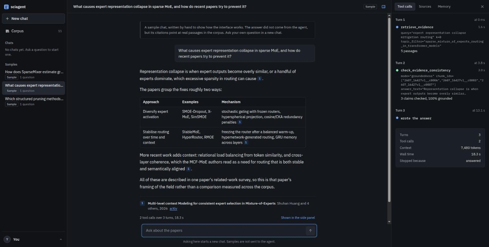
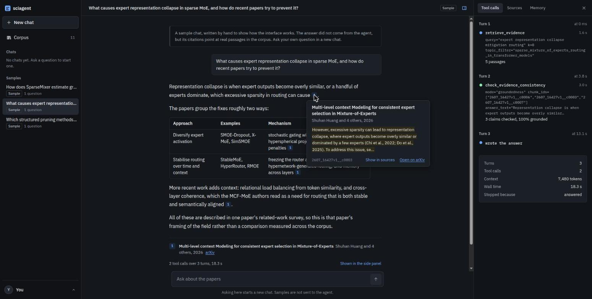
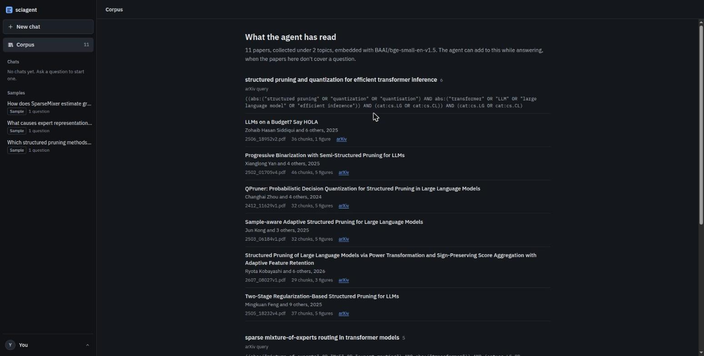

# sciagent: an agentic research assistant over arXiv papers

Ask a research question. The agent decides which tools it needs, retrieves evidence from a
corpus of arXiv papers, reads figures when the text is not enough, checks its draft
against the sources, and answers with a citation on every claim. When the corpus cannot
support an answer, it says so, and offers to fetch papers on the subject if you approve.
It is topic-agnostic: a topic is a runtime argument, and
[`examples/cold_start.md`](examples/cold_start.md) takes a field the eval never touches
from an empty index to a cited answer. The loop is hand-written: no agent framework.



*A sample chat from the browser UI, hand-written to show the panes; its citations point at real passages in the corpus.*

## What makes it agentic

- **The model chooses its tools.** It gets five tool schemas and no router. Most
  questions need only `retrieve_evidence`; some need a figure, an NLI check or corpus
  statistics, and the model decides which.
- **Abstention is a mechanism, not a prompt.** A relevance gate thresholds the
  cross-encoder's score (−3.0, swept on the tuning split). Below it, chunks are withheld
  and the tool returns `sufficient_evidence: false`, so the model has nothing weak to
  answer from.
- **Corrective RAG, with a human approving every fetch.** When the answer cites nothing,
  the agent describes the gap and the UI offers a **Fetch papers** button, with a query
  rewritten from your question. Before anything is downloaded, an admission gate scores
  each arXiv abstract with the cross-encoder.
- **Short- and long-term memory, with automatic forgetting.** Chats are threads in SQLite
  with a 9k-token history budget. Across chats, the agent keeps findings that NLI confirms
  against their cited passages, and preferences you state. Memories are superseded by
  contradictions, go stale when a passage changes, and decay when unused. You can view,
  edit, add and restore them on a Memories page.
- **Hybrid retrieval, measured.** BM25 and a BGE bi-encoder are fused with RRF, then a
  cross-encoder reranks the pool of 40. Retrieval-only, on the tuning split, this raised
  pool recall@40 from 0.400 to 0.567 and MRR from 0.344 to 0.479. Contextual chunk headers
  were built too, measured worse, and ship off.
- **A hand-written loop, on purpose.** About 550 lines against OpenRouter's
  OpenAI-compatible API, with per-tool call limits and two termination backstops. How the
  loop is structured was itself under evaluation, and its policies (an image attached on a
  follow-up turn, elision that keeps tool-call pairs intact) would be overrides inside a
  framework ([why](docs/research/framework-comparison.md)).

## Results

Final run, 2026-10-25, of the full agent: 11 papers, 406 chunks, 18 hand-annotated
questions in 5 categories (`eval/results/final_tuning.json`, `final_held_out.json`).

| metric | tuning (12 q) | held out (6 q) |
|---|---|---|
| fact coverage (answerable questions) | 1.000 | 1.000 |
| abstention accuracy | 1.000 (12 of 12) | 1.000 (6 of 6) |
| citations resolved | 0.971 | 1.000 |
| gold-paper hit rate | 1.000 (8 of 8) | 1.000 (4 of 4) |
| recall@5 (agent-level) | 0.321 | 0.333 |
| MRR (agent-level) | 0.906 | 0.446 |
| fetch proposed, absent-but-fetchable | 1.000 (3 of 3) | 1.000 (2 of 2) |
| false fetch proposal, answerable | 0.125 (1 of 8) | 0.000 (0 of 4) |

n is small: 12 tuning and 6 held out, so one question moves a rate by 0.125 on the 8
answerable tuning questions and by 0.25 on the 4 held-out ones. Each figure is one run of a
hosted model. Agent-level MRR and recall count every chunk the agent saw across its calls,
so they are not the retrieval-only figures above. Details, earlier runs and what the
numbers do not say: [`docs/EVALUATION.md`](docs/EVALUATION.md).

## Quick start

```bash
python3 -m venv .venv && source .venv/bin/activate      # Python 3.10+
pip install -r requirements.txt -r web/requirements.txt
echo "OPENROUTER_API_KEY=sk-or-..." > .env
cd frontend && npm ci && npm run build && cd ..        # Node 20.19+ or 22.12+
python web/server.py
```

Open <http://127.0.0.1:8000>. The first run downloads three local models (~500 MB). The
repo's index holds the 11 eval papers. To start from your own topic, run
`python main.py index "<topic>"` first. Setup details, GPU and environment variables are in
[`docs/USAGE.md`](docs/USAGE.md).

## Architecture

Two phases. **Indexing** is slow and runs once per topic. **Asking** reads what indexing
produced. They share nothing but files on disk.

```
index "<topic>"
  arXiv query planned by an LLM → search, dedup against the manifest, download PDFs
  → PyMuPDF text; figures rendered and described by a vision model
  → section-aware chunks (≤445 tokens)
  → BGE embeddings → FAISS IndexFlatIP + persisted chunk_id map   (BM25 built in memory)

ask "<question>"  [in a thread]
  thread history (≤9k tokens) + relevant long-term memories, with their passages
  agent loop ── the model picks tools; ≤10 calls per tool (search_literature 5)
     │
     ├─ retrieve_evidence          per (sub-)query, ≤3: BGE top-40 + BM25 top-40 → RRF pool of 40
     │                             → cross-encoder rerank → relevance gate (withhold weak)
     │                             → top-5 + ±1 neighbours; a coverage_gap hint on failure
     ├─ search_literature          only after the user approves: admission gate on
     │                             abstracts, then download and index
     ├─ analyze_corpus             stats, timeline, KMeans clustering
     ├─ inspect_figure             the figure image, attached on a follow-up user turn
     └─ check_evidence_consistency NLI: contradictions, groundedness
  → answer with a [chunk_id] citation on every claim
  → no citation? a fetch proposal → the "Fetch papers" button → an approval turn
  → in a thread: NLI-entailed findings written to memory, then a forgetting sweep
```

### Design choices

- **No agent framework.** The loop (`src/agent/loop.py`) is written directly against the
  provider's API, so its structure is visible and testable. The comparison with LangGraph,
  Pydantic AI, the OpenAI Agents SDK and LlamaIndex, and when to switch, is in
  [`docs/research/framework-comparison.md`](docs/research/framework-comparison.md).
- **Statelessness is handled explicitly.** `/chat/completions` stores nothing, so the whole
  message array is rebuilt every turn. `agent/conversation.py` enforces the API's pairing
  rules. Past a token budget, old tool results have their *content* replaced, because
  deleting a message orphans its `tool_call` and the API rejects the request.
- **Retrieve wide, pass narrow.** BM25 and the bi-encoder score the whole index cheaply.
  The cross-encoder only ever rescores the fused pool of 40.
- **Rerank is kept for the gate, not the ranking.** At this corpus size it bought +0.027
  MRR for +1.5 s, below the noise floor. Turning it off swaps a cross-encoder logit for a
  cosine and silently disables abstention. No cosine threshold recovers it.
- **Answering is autonomous; changing the corpus is not.** A fetch permanently changes what
  every later question searches, so the agent proposes and the user approves.
- **Every threshold is measured.** `config.yaml` carries the sweep or measurement behind
  each number.

Full design, with rejected alternatives: [`docs/ARCHITECTURE.md`](docs/ARCHITECTURE.md).
Every decision, who made it and why: [`docs/DECISIONS.md`](docs/DECISIONS.md).

## Usage

**Browser.** `python web/server.py` (add `--port N` for another port). There are three
panes: chats, samples and the corpus on the left; the conversation in the centre; and on
the right, the agent's tool-call timeline, the cited sources, and the memory it used.
Clicking a citation opens the cited passage. The three Sample chats are hand-written
fixtures with real citations, so you can see the panes without making an API call.
Long-term memories are managed at `#/memories`, from the user menu at the bottom left.

| Citation card | Corpus view |
|---|---|
|  |  |

**CLI.** The same agent, through the same config:

```bash
python main.py index "sparse mixture-of-experts routing in transformer models"
python main.py ask "What load-balancing losses do these papers use?" --new-thread
python main.py ask "Which of those report downstream results?" --thread <id>
python main.py ask --thread <id> --approve-fetch "<query>"    # approve a proposed fetch
python main.py eval [--held-out]
```

Every flag, the full UI tour, the Memories page and the HTTP API are in
[`docs/USAGE.md`](docs/USAGE.md).

## Layout

```
main.py                CLI: index / reindex / ask (--thread) / threads / eval
config.yaml            every tunable, with the measurement behind each value
src/
  config.py            config + secrets loading
  llm_client.py        the OpenRouter wrapper: retries, image attachment
  common/              storage, records, tokenization
  corpus/              arXiv query planning, collection, admission gate, manifest, chunk store
  extraction/          PDF text, chunking, figure rendering, vision descriptions
  retrieval/           embedder, FAISS index, BM25, indexer, cross-encoder reranker
  tools/               the five agent-facing tools
  agent/               tool registry, conversation, trace, fetch proposal, the loop
  memory/              threads in SQLite, thread history, long-term memory and forgetting
  analysis/            NLI
  prompts/             system prompt, tool descriptions and every other prompt, as files
eval/                  question set, metrics, runner, sweeps and ablations
web/                   FastAPI server: streams agent steps as SSE
frontend/              React + Vite + TypeScript, Tailwind v4, KaTeX; built into frontend/dist/
scripts/               one verification gate per milestone (m0..m8), plus the M9 demos
tests/                 unit and smoke tests
docs/                  the specs, decisions and results
```

`eval/`, `web/` and `frontend/` sit outside `src/` and import it, never the reverse. The
browser runs the same `AgentLoop` as `main.py ask`, so no answer can appear there that the
CLI would not give.

## Configuration

Everything tunable is in `config.yaml`, each value with the measurement behind it. The key
rows:

| key | value | why |
|---|---|---|
| `retrieval.k_retrieve` / `k_final` | 40 / 5 | wide cheap pool, narrow expensive context |
| `retrieval.hybrid` / `rrf_k` | true / 60 | BM25 beside the bi-encoder; pool recall@40 0.400 → 0.567 |
| `retrieval.relevance_threshold` | −3.0 | the abstention gate; swept −8..+2 on the tuning split only |
| `retrieval.bi_encoder_relevance_threshold` | 0.55 | the gate when the cross-encoder did not run; a degraded fallback |
| `retrieval.contextual_headers` | false | measured to lower pool recall here |
| `collection.admission_threshold` | −3.0 | abstracts below it are never downloaded |
| `agent.max_calls_per_tool` / `tool_call_limits` | 10 / `search_literature: 5` | per question; no global iteration cap |
| `agent.max_no_progress_turns` | 3 | turns with nothing run before a forced answer |
| `agent.thread_history_tokens` | 9000 | a thread's earlier turns; the oldest go first, whole |
| `memory.half_life_days` / `min_strength` / `max_active` | 30 / 0.125 / 500 | used once and unused for 90 days is forgotten |
| `chunking.max_tokens` | 445 | the smaller of the two encoders' budgets |

Models are set per role (`agent_model`, `vision_model`, `utility_model`). The agent model
must accept **both tools and images**, because `inspect_figure` attaches a figure to the
agent's own conversation.

## Tests

```bash
env -u PYTHONPATH python -m pytest tests/ -q     # 478 tests
python scripts/m5_gate.py                        # one milestone's verification gate
```

`env -u PYTHONPATH` keeps a system `PYTHONPATH` (ROS sets one) from leaking foreign pytest
plugins into the run. Unit tests are not the main safety net. Each milestone ended at a
gate, `scripts/mN_gate.py`, that runs the real pipeline on real data and prints pass/fail
per claim. Nearly every real defect was caught that way, not by an assertion
([`docs/ARCHITECTURE.md`](docs/ARCHITECTURE.md) §15).

## Documentation

| | |
|---|---|
| [`docs/USAGE.md`](docs/USAGE.md) | setup, every CLI flag, the browser UI, the HTTP API |
| [`docs/ARCHITECTURE.md`](docs/ARCHITECTURE.md) | the design, its rejected alternatives, and §15 on how AI agents were used to build it |
| [`docs/DECISIONS.md`](docs/DECISIONS.md) | D1–D34: every build decision since M9, who made it and why |
| [`docs/TOOLS.md`](docs/TOOLS.md) | the five tools: signatures, return shapes, failure modes |
| [`docs/DATA_SCHEMA.md`](docs/DATA_SCHEMA.md) | records, ids, hashes, on-disk layout, the memory table |
| [`docs/EVALUATION.md`](docs/EVALUATION.md) | what was measured, and what the numbers do not say |
| [`docs/FUTURE_WORK.md`](docs/FUTURE_WORK.md) | what to build next, ranked, and the known limitations |
| [`docs/BUILD_PLAN.md`](docs/BUILD_PLAN.md) | the milestones M0–M9 and their verification gates |
| [`docs/research/`](docs/research/) | the 2026 agentic-engineering landscape mapped to this project, and a framework comparison |
| [`examples/`](examples/) | worked examples from scored runs, and a cold start on a new field |
