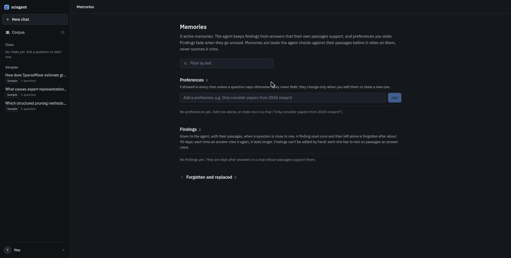

# Usage

The full reference for running the project. The README has the short version.

## Setup

Python 3.10+. Developed and tested on **Python 3.10.12**, Linux.

```bash
python3 -m venv .venv
source .venv/bin/activate
pip install -r requirements.txt -r web/requirements.txt
```

`requirements.txt` pins the system under evaluation. `web/requirements.txt` pins only the
browser UI's server (FastAPI, uvicorn, and httpx for its tests).

The first run downloads three models from HuggingFace (~500 MB total): the bi-encoder
`BAAI/bge-small-en-v1.5`, the cross-encoder `ms-marco-MiniLM-L-6-v2`, and
`nli-deberta-v3-small`. They are cached afterwards.

### Environment

Create a `.env` in the repo root:

```bash
OPENROUTER_API_KEY=sk-or-...      # required: every LLM call goes through OpenRouter
OPENROUTER_APP_NAME=sciagent      # optional, used in the attribution header
```

| variable | required | purpose |
|---|---|---|
| `OPENROUTER_API_KEY` | yes | LLM, vision and utility calls |
| `OPENROUTER_APP_NAME` | no | OpenRouter attribution header, defaults to `sciagent` |
| `SCIAGENT_CONFIG` | no | use a different `config.yaml`; paths live in it, so this selects a separate corpus |
| `SCIAGENT_BACKEND` | no | frontend dev server only: where Vite proxies `/api` (default `http://127.0.0.1:8000`) |

### GPU (optional)

Three models run locally: the bi-encoder, the cross-encoder reranker and the NLI model.
`compute.device` in `config.yaml` governs all three.

`auto` (the default) uses CUDA when torch can reach a device and falls back to CPU, so the
project runs unchanged with no NVIDIA driver present. Naming a device explicitly (`cuda`,
`cpu`) is a hard assertion instead: an unreachable device fails at config resolution
rather than quietly dropping to CPU, because a silent fallback turns a driver problem into
an unexplained slowdown.

```bash
python scripts/check_gpu.py              # reports the device and times the models
python scripts/check_gpu.py --skip-bench # report the device only
```

It is worth having for indexing and the eval harness, and makes no difference to a single
question: the CUDA context costs more to start than one query saves.

## The browser UI

### Build and run

```bash
cd frontend && npm ci && npm run build   # Node 20.19+ or 22.12+ (Vite 8); writes frontend/dist/
cd ..
python web/server.py
```

It loads the models first, which takes about ten seconds, then prints:

```
loading models and the index ...
ready — 11 paper(s) indexed
open http://127.0.0.1:8000
```

Open that address. Stop it with `Ctrl-C`. If `frontend/dist/` is missing, the API still
runs, and the page tells you to run the build command.

```
--port N        listen on a different port (default: 8000)
--host H        default 127.0.0.1, this machine only.
                --host 0.0.0.0 makes it reachable from another machine on the network
--config PATH   is NOT a flag here; use SCIAGENT_CONFIG=... python web/server.py instead
```

**Frontend development.** Keep `python web/server.py` running, then
`cd frontend && npm run dev` and open the address Vite prints (default
<http://127.0.0.1:5173>). Vite proxies `/api` to `127.0.0.1:8000`; set `SCIAGENT_BACKEND`
if the server listens elsewhere. `npm run typecheck` runs `tsc` alone, and
`npm run check:markdown` runs the answer renderer's checks (math, citations, escaping).
Styling is Tailwind v4, with the palette, type scale and radii as tokens in
`frontend/src/styles.css` (`docs/DECISIONS.md` D8, D11). Answers render math with KaTeX (D7).

### The three panes

**Left: chats and corpus.** *New chat*; *Chats*, the stored threads, newest first, each one
deletable; *Samples*; and *Corpus*: every indexed paper grouped by the topic it was
collected under, with the arXiv query the LLM planned for that topic. Per paper it lists
title, authors, year, PDF filename, chunk and figure counts, and an arXiv link. A chat is
created by its first question and named after it. Opening one redraws its answers,
citations and per-answer timeline from the server. The three **Sample** chats are
hand-written fixtures, not stored threads, so asking from one starts a new chat. Their
citations point at real passages, but the agent did not write them (D10).

**Centre: the conversation.** Each question goes to the same agent as
`python main.py ask --thread`, through the same config. There is no second code path, and
no answer can appear here that the CLI would not also give. The agent sees the earlier
questions and answers in this chat, and a note of the tools each one used, but not the
passages. It retrieves those again, and the page says so under the composer. While the
agent works, a status line shows what it is doing. Every citation is numbered like a
paper's references, and clicking it opens the cited passage with an arXiv link. A
reference list sits under the answer. Figures the agent looked at with `inspect_figure`
appear inline.

**Right: the agent's working.**
- *Tool calls* is a turn-by-turn timeline of the selected answer, live while it runs: the
  tool, its arguments, what came back (expandable) and how long it took, plus skipped calls
  and stops. It ends with the run's stats: turns, tool calls, context tokens, why it
  stopped, and the trace's run id.
- *Sources* lists the cited passages per paper, and how many earlier turns were sent.
- *Memory* has two parts. *Across chats* lists the long-term memories used in the answer
  (with their citations and whether they were cited) and those written from it (new, seen
  again, replaced), then every active memory with uses, last use, strength and a delete
  button, a collapsed *Forgotten* list, and a *Manage memories* link. *In this chat* is the
  short-term part: the tool-call notes a later question in this chat is shown.

On narrow screens the right panel becomes a drawer.

### The Memories page (`#/memories`)

Open it from the user menu at the bottom left ("You"; there is one user and no sign-in),
which also holds the theme. It lists every long-term memory (D23), with a text filter:



- *Preferences*: add one ("Only consider papers from 2024 onward"), or edit or delete one.
  A restatement of an existing preference refreshes it instead of adding a copy.
- *Findings*: each with its passages as chips (they open the citation card), its uses,
  when it was last used, a strength meter with how many days it has left unused, and the
  chat it came from. Edit or delete one. An edit is re-checked by NLI against the
  finding's passages. If they don't support the new wording, it is kept but flagged
  "Edited by you; not supported by its passages", and the agent is told so. Findings can't
  be added by hand: each must rest on passages an answer cited.
- *Forgotten and replaced* (collapsed): why each one went (faded, over the cap, replaced
  by a newer finding, its passage changed, deleted by you), when it is deleted for good,
  and a *Restore* button. Restore counts as a use. A finding whose passage has changed
  can't be restored, and a row past `purge_after_days` is gone.

### The Fetch papers button

When the answer cites nothing from the corpus (D34), a card under it names the gap and the
closest topics the corpus holds. The card has an editable query, suggested from your
question (D28), and a **Fetch papers** button. Clicking it is your approval: nothing is
ever fetched without it. The fetch runs as the chat's next turn. The agent calls
`search_literature`, an admission gate drops arXiv results whose abstracts do not match
the query (the step says how many), and the agent then answers your original question
with citations to the new papers. Once used, the button is gone. Only the latest answer's
card can fetch (D27).

That `search_literature` step can sit in the timeline for minutes: fetching PDFs,
extracting them, describing figures and embedding all happen inside that one tool call.
Fetched papers stay in the corpus. For a demo, index the topic beforehand.

### Limits

It needs Python, the models and an index, so it cannot be hosted as a static site. Run it
on the machine that has the corpus. It holds one agent and answers one question at a time
(D6). A second question asked meanwhile is told straight away that the agent is busy.
Closing the tab does not cancel a run: the question finishes, and its trace is written,
before the agent takes another. There is no authentication, and it binds to localhost by
default.

### API

- `GET /api/papers`: the corpus.
- `POST /api/ask` with `{"question": ..., "thread_id"?: ...}`, or
  `{"thread_id": ..., "approve_fetch": {"query": ...}}` to run an approved fetch. The reply
  is a server-sent event stream (D5): `thread` first, naming the chat (new if no
  `thread_id` was sent); then `step`…; then `answer` (carrying `fetch_proposal`) or
  `failed`; then `memory` `{written, refreshed, invalidated, used, forgotten, dropped}`;
  then `done`. Or else `busy`, `done`.
- `GET`/`POST /api/threads`; `GET`/`DELETE /api/threads/<id>`.
- `GET /api/memories` (`?all=1` adds the forgotten, with reasons; each row carries
  strength, days left, passages and whether its chat still exists, plus the forgetting
  `settings`); `POST /api/memories` `{"kind": "preference", "text": ...}`;
  `PATCH /api/memories/<id>` `{"text": ...}`; `DELETE /api/memories/<id>`;
  `POST /api/memories/<id>/restore`.
- `GET /api/figures/<paper_id>/<file>` (D9); `GET /api/status`.

## The CLI

`main.py` has five subcommands: `index`, `reindex`, `ask`, `threads` and `eval`. A global
`--config PATH` (before the subcommand) selects another `config.yaml`, and so another
corpus.

### Index a topic

```bash
python main.py index "sparse mixture-of-experts routing in transformer models"
```

Searches arXiv, downloads the PDFs, extracts text and figures, describes each figure with
a vision model, then embeds and indexes everything. Re-running is cheap: papers already
held are not re-downloaded, embeddings are cached by the hash of the exact embedder
input, and figure descriptions are cached by image hash.

```
--max-results N         papers to fetch (default: collection.max_results_default)
--categories ...        restrict to arXiv categories, e.g. cs.CL cs.LG
--no-describe           skip vision calls; figures index on caption text alone
--clear-arxiv-cooldown  forget a recorded arXiv 429 cooldown
--rebuild               rebuild the vector index from scratch
```

Indexing a second topic adds to the *same* index: papers are distinguished by
`topic_tags`, and a paper found under two topics gains both tags. `main.py index` is an
explicit user command, so it skips the admission gate that `search_literature` applies
(D16).

`python main.py reindex` re-embeds the chunks already held, with no arXiv call. It is the
step to run after changing what the first stage embeds, e.g.
`retrieval.contextual_headers`. Unchanged inputs hit the cache.

### Ask a question

```bash
python main.py ask "What load-balancing losses do these papers use for MoE routing?"
python main.py ask "..." --show-tools     # after the answer, one line per tool call
python main.py ask "..." --quiet          # no live progress
```

While it runs, each step is printed to **stderr**: the model thinking, every tool call
with its arguments, what came back and how long it took.

```
[1] thinking...
[1] → retrieve_evidence(query='sparse mixture-of-experts load balancing') ... 8 chunks, 6796ms
[2] thinking...
[2] → check_evidence_consistency(mode='groundedness', ...) ... 20 claims, grounded 0.5, 45571ms
[3] answering
```

The answer goes to stdout, so `ask "..." > answer.txt` captures the answer alone.
Afterwards it prints the iteration count, tool-call count, context size, why the loop
stopped, the calls made per tool, and the path to a JSONL trace of every tool call under
`logs/traces/`.

**Threads.** Questions are independent unless you put them in a thread, where each new
question is sent with the earlier questions, answers and a one-line note per tool call
(`docs/ARCHITECTURE.md` §7.1):

```bash
python main.py ask "What load-balancing losses do these papers use?" --new-thread   # prints the thread id
python main.py ask "Which of those also report downstream results?" --thread <id>
python main.py threads                    # id, turns, last updated, title
```

Threads live in `data/threads.sqlite3`, shared with the browser UI, so a chat started in
one can be continued in the other. The eval never uses them.

**Long-term memory.** A thread run also uses long-term memory (`docs/ARCHITECTURE.md`
§7.2). After the answer, the claims it cites that NLI finds entailed by their passages are
remembered, along with preferences you stated outright ("only papers from 2024 onward").
A later chat on the same subject is given the relevant ones with their passages, to check
and cite. Memories fade when unused and are replaced when contradicted. `ask` prints a
`--- memory:` line.

**Fetching.** When the answer cites nothing, the agent does not fetch on its own. It says
what it searched for and which held topics came closest, and the run ends with a line like
`--- fetch proposal: "<query>"  (re-ask with --approve-fetch)`. To approve, continue the
same thread (D26):

```bash
python main.py ask --thread <id> --approve-fetch "<query>"   # fetch, then answer the previous question
```

### Run the eval

```bash
python main.py eval               # the 12-question tuning split
python main.py eval --held-out    # the 6 held-out questions
python main.py eval --limit 3     # a quick smoke run (saved separately, so it
                                  # cannot overwrite a full run's results)
python main.py eval --out NAME    # write eval/results/NAME.json instead
python main.py eval --no-groundedness   # skip the NLI groundedness pass
```

Results land in `eval/results/`. The write-up is [`EVALUATION.md`](EVALUATION.md).

### Examples

- [`examples/worked_examples.md`](../examples/worked_examples.md): an abstention, a
  conflicting-evidence case and a multi-paper synthesis, lifted from scored M8 eval runs.
- [`examples/cold_start.md`](../examples/cold_start.md): a topic from a different field,
  taken from nothing to an answered question, with every tool call shown. Regenerate with
  `python scripts/m9_cold_start.py --fresh`; it builds into `data_demo/`, so it cannot
  disturb the eval corpus in `data/`.
